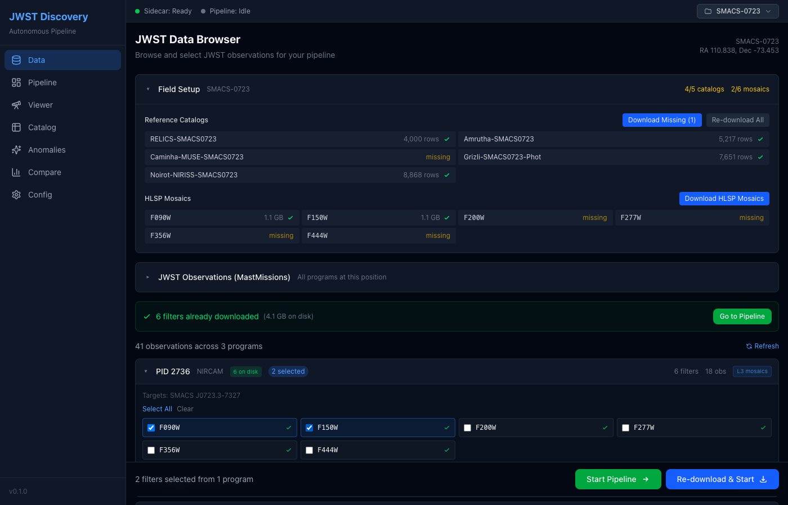
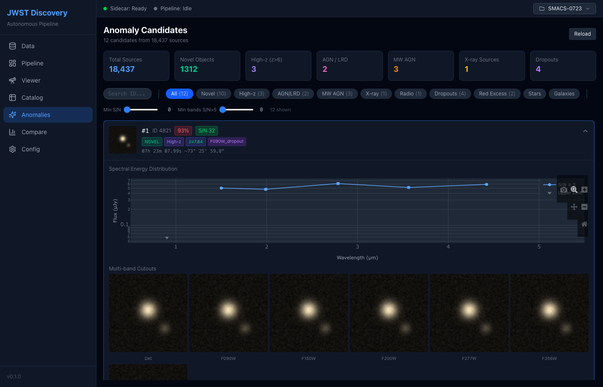
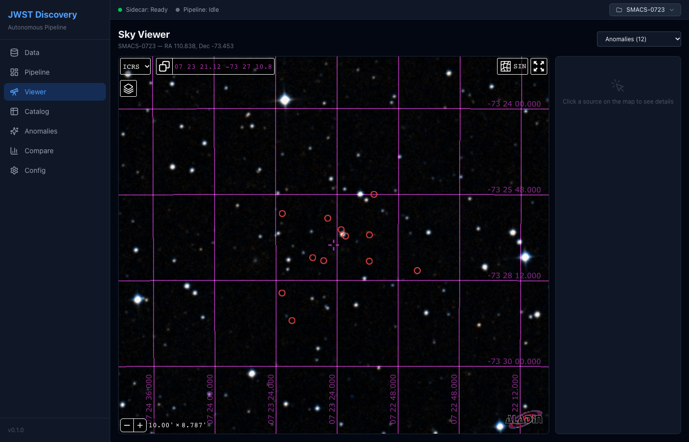

<p align="center"></p>

# JWST Discovery

**A desktop app and Python pipeline that turns public JWST NIRCam mosaics into a vetted catalog of sources with no counterpart in any reference catalog.**

Point it at a field. It downloads the Level-3 mosaics from MAST, detects and measures every source, fits photometric redshifts, cross-matches against 50+ reference catalogs and 13 live archives, flags whatever is unmatched, ranks it with an Isolation Forest, and hands you cutouts, SEDs and a candidate list to look at.

It has been run end to end on **27 fields and 690,358 sources** (29 fields are registered). The validation layer encodes every artifact class those runs produced, so a candidate that reaches the top of the list has already passed 16 automated checks. The full catalog of failure modes is in [jwst-archival-pitfalls](https://github.com/vinaysingh8866/jwst-archival-pitfalls).

*Example `report` stage output: per-band cutouts and the fitted SED for each top-ranked source. The validation scripts then classify each one.*

---

## What's in the box

| Layer | Stack | Role |
|---|---|---|
| Desktop app | Tauri 2 (Rust) + React 19, Vite, Tailwind, Zustand, Aladin Lite, Plotly | Configure a field, watch stages run, browse the catalog, inspect anomalies, compare runs |
| Pipeline sidecar | Python 3.11, astropy, sep, photutils, eazy-py, polars, scikit-learn | The nine stages below, driven over an NDJSON stdin/stdout protocol |
| Field CLI | `jwst-field` | Run the same pipeline headless on any of the 29 registered fields, or your own |
| Validation scripts | `scripts/validation/` | 16 automated artifact checks per candidate, dual-template photo-z cross-check, cutout image classifier |
| Tests | `sidecar/tests/`, `src/**/*.test.ts`, `e2e/`, `src-tauri` | 65 pytest + 77 vitest + 21 cargo tests, all offline, plus a Playwright suite that drives the UI in Chromium with the Tauri host mocked; ruff, eslint and clippy clean |

## Screenshots

Data page: MAST search results, field setup and filter selection.



Anomalies page: ranked candidate cards with badges, the interactive SED and multi-band cutouts.



Sky Viewer: Aladin Lite centred on the field with the candidate overlay.



A page-by-page tour of the app, with every screenshot, is in [docs/USAGE.md](docs/USAGE.md). The screenshots are regenerated by `npm run test:e2e` from a synthetic fixture workspace.

### The nine stages

| # | Stage | What it does |
|---|---|---|
| 1 | `ingest` | Parallel download of Level-3 `i2d` mosaics from MAST, with a resumable manifest |
| 2 | `preprocess` | Background subtraction, reprojection to a common WCS grid, inverse-variance detection image |
| 3 | `detect` | SEP source extraction with configurable threshold and deblending; segmentation map |
| 4 | `deblend` | Optional PSF-aware Scarlet2 deblending of crowded blends (off by default) |
| 5 | `measure` | Forced aperture (0.16", 0.32", 0.5") and Kron photometry in every band, AB magnitudes |
| 6 | `characterize` | Colours, morphology (Gini, M20, asymmetry, concentration), star/galaxy split, EAZY photo-z, dropout and AGN/LRD flags |
| 7 | `crossmatch` | Local reference catalogs plus NED, SIMBAD, Gaia, SDSS, PanSTARRS, Chandra, XMM, CatWISE, VLASS, eROSITA, HSC, HCV, Spitzer. Unmatched sources are flagged `novel` |
| 8 | `anomaly` | Isolation Forest over a 22-dimensional feature space, spike-artifact rejection, confidence tiers |
| 9 | `report` | Cutouts, SED plots and `candidates.json` for the top N |

Everything is Parquet on disk under `~/.jwst-discovery/workspaces/<field>/`, so you can pick up the catalogs in polars or pandas without the app.

---

## Quick start

### Headless pipeline (any OS)

```bash
git clone https://github.com/vinaysingh8866/jwst-discovery
cd jwst-discovery
pip install -e "sidecar[dev]"

jwst-field list                       # the 29 registered fields
jwst-field download SMACS-0723        # ~6 GB of NIRCam mosaics from MAST
jwst-field run SMACS-0723             # preprocess → report, ~20 min on a laptop
```

Results land in `~/.jwst-discovery/workspaces/SMACS-0723/{catalogs,report}`. Set `JWST_WORKSPACE_ROOT` to put them elsewhere.

To add your own field, add one dict to `sidecar/jwst_pipeline/fields.py`. Fields whose mosaics come from HLSP or the DAWN JWST Archive rather than MAST have hand-written recipes in `scripts/downloads/`, and the CLI will point you at the right one.

### Desktop app

Requires Node 20, Rust stable, and the sidecar installed as above.

```bash
npm install
scripts/build_sidecar.sh --stub   # placeholder so the Tauri build script finds its resource
npm run tauri dev                 # runs the sidecar as python -m jwst_pipeline from sidecar/
```

To build a distributable app, package the sidecar first and then build:

```bash
scripts/build_sidecar.sh   # PyInstaller one-dir build → src-tauri/sidecar-dist/jwst-pipeline/
npm run tauri build
```

See [docs/BUILDING.md](docs/BUILDING.md) for per-OS prerequisites and the `JWST_DEV_SIDECAR` / `JWST_SIDECAR_BIN` overrides.

### Development

```bash
cd sidecar && pytest -q && ruff check .     # 65 tests: protocol loop, CLI, field registry, synthetic end-to-end
npm test                                    # 77 vitest tests: stores, reducers, hooks, formatters, workspace resolution
npm run lint && npm run typecheck           # eslint (typescript-eslint + react-hooks) and tsc
npx playwright install chromium && npm run test:e2e   # Playwright: the UI in Chromium with the Tauri host mocked; writes docs/screenshots/
cd src-tauri && cargo test && cargo clippy --all-targets -- -D warnings
```

The sidecar test suite includes a synthetic workspace fixture (three fake NIRCam mosaics with injected point sources) that runs preprocess → detect → measure → characterize offline. Tests that need the network are marked `network` and skipped by default.

### Disk and time

A field is 5 to 15 GB of mosaics and a similar amount of intermediate products. The full 29-field survey used about 440 GB. Cross-match stages talk to live archives and can take an hour on a crowded cluster field.

---

## Validation

An unmatched source is usually an artifact or a catalog gap. `scripts/validation/scrutinize_candidates.py` runs 16 checks on every candidate, each targeting a specific failure mode:

| Check | Catches |
|---|---|
| EAZY grid edge | Every source with z > 12.8 sits at exactly z = 12.873, the template grid ceiling |
| Photo-z quality | High chi2, and suspiciously low chi2 (< 0.1) from underconstrained fits |
| SED consistency | Flux detected below the supposed Lyman break |
| Single-band spike | One-band flux spikes from hot pixels and cosmic rays |
| Morphology | Unresolved, elongated or asymmetric shapes inconsistent with a galaxy |
| Band coverage | Too few valid bands for a trustworthy redshift |
| Proximity | Mosaic edges and bright-star neighbours |
| Multi-wavelength | Gaia counterpart at "high z" means foreground star |
| Duplicates | Same source detected twice within 1" |
| SED slope | V-shaped SEDs with a > 1 mag dip |
| Crowding | More than 30 sources within 3" is a deblending artifact zone |
| Bright neighbour | A much brighter source nearby means a deblend fragment |
| Fragment cluster | Several fragment-flagged sources clustered together |
| ICL contamination | Extended, low surface brightness, low chi2, near a cluster core |
| Brightness vs novelty | Brighter than mag 23 with zero matches means the reference catalogs are incomplete |
| Catalog gap | Published catalogs covering the field that are not in the reference set |

`auto_inspect_candidates.py` classifies the cutout images themselves (real, noise, artifact, fragment, edge, crowded) and `run_photoz_crosscheck.py` refits every candidate with a second template set. `consolidate_validation.py` merges all three into a final verdict per source.

---

## Repository layout

```
src/                 React frontend (pages: Data, Viewer, Catalog, Anomalies, Compare, Config; components/, stores/, hooks/, lib/)
src-tauri/           Rust host: FITS I/O, sidecar process management, Tauri commands
sidecar/
  jwst_pipeline/     the pipeline package
    stages/          one module per stage
    fields.py        registry of the 29 fields and their tuned configs
    cli.py           `jwst-field`
    catalog_registry.py   reference-catalog and HLSP-mosaic definitions per field
  tests/             protocol loop, CLI, registry, stage contract and synthetic end-to-end tests
scripts/
  validation/        candidate scrutiny, image inspection, photo-z cross-check, consolidation
  downloads/         field-specific mosaic and reference-catalog download recipes
  cross_archive/     DJA, Spitzer, Euclid, Gaia/CSC/WISE catalog downloaders
  field_selection/   find JWST cluster fields that have no published catalog yet
  experiments/       colour-outlier search, GC overdensities, emission-line search, figure scripts
docs/                BUILDING.md, architecture plan, images
```

---

## Survey run

| | |
|---|---|
| Fields | 27 (29 registered) |
| Sources | 690,358 |
| Unmatched against all reference catalogs | 55,782 |
| Candidates at z > 6 passing all validation checks | 0 |

The unmatched fraction tracks reference-catalog coverage: deep fields with public catalogs (JADES, CEERS, NGDEEP) come out near zero, clusters with no published JWST catalog come out at 30 to 50 percent. Use the unmatched fraction as a measure of catalog completeness for a field.

The validated candidate table and photo-z cross-check are on Zenodo: [10.5281/zenodo.19394042](https://doi.org/10.5281/zenodo.19394042).

---

## Roadmap

- Workspace root as an in-app setting (currently `~/.jwst-discovery`, overridable with `JWST_WORKSPACE_ROOT` for the CLI).
- Move the field and reference-catalog registries from Python modules to YAML.
- Per-pixel artifact-risk maps (persistence, diffraction spikes, seams) as a first-class stage.
- Code-split the Aladin Lite and Plotly bundles.

Issues and PRs welcome. If you run this on a new field, open an issue with the field name and the unmatched fraction so it can be added to the registry.

## Related repositories

- [jwst-archival-pitfalls](https://github.com/vinaysingh8866/jwst-archival-pitfalls): catalog of artifact classes and archive-access failures, with the check for each
- [jwst-nircam-timedomain](https://github.com/vinaysingh8866/jwst-nircam-timedomain): multi-epoch difference imaging and the NIRCam persistence false-positive rate

## Citation

If this pipeline is useful in your work, please cite the Zenodo record above and link this repository.

## License

MIT. Copyright (c) 2026 Vinay Singh.
