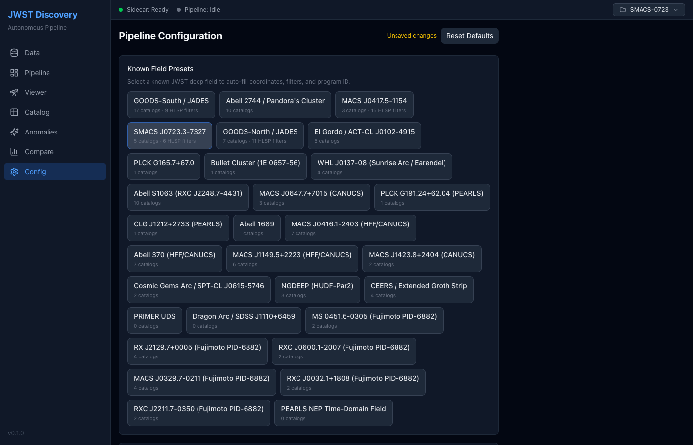
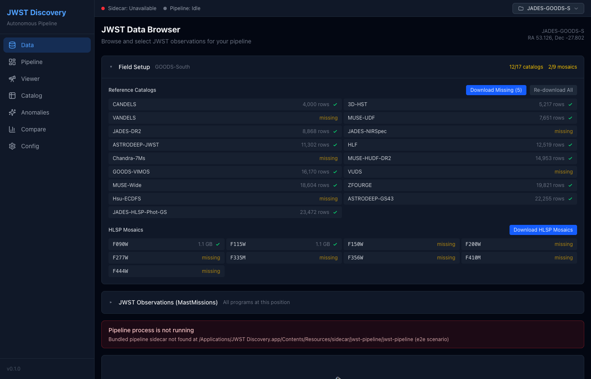
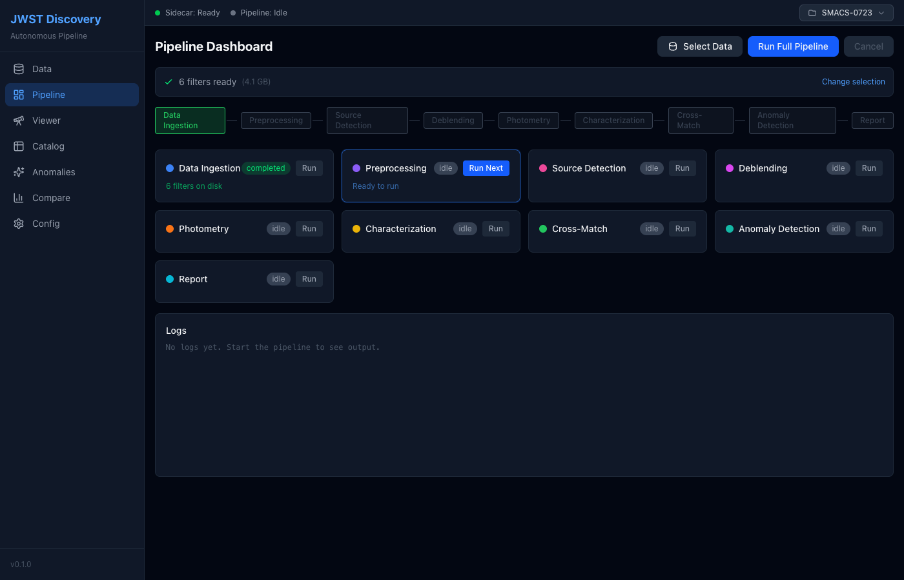
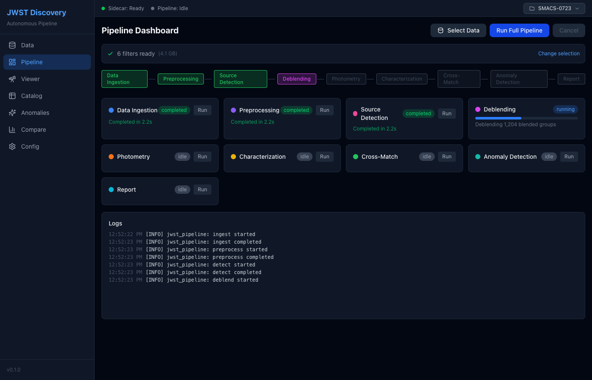
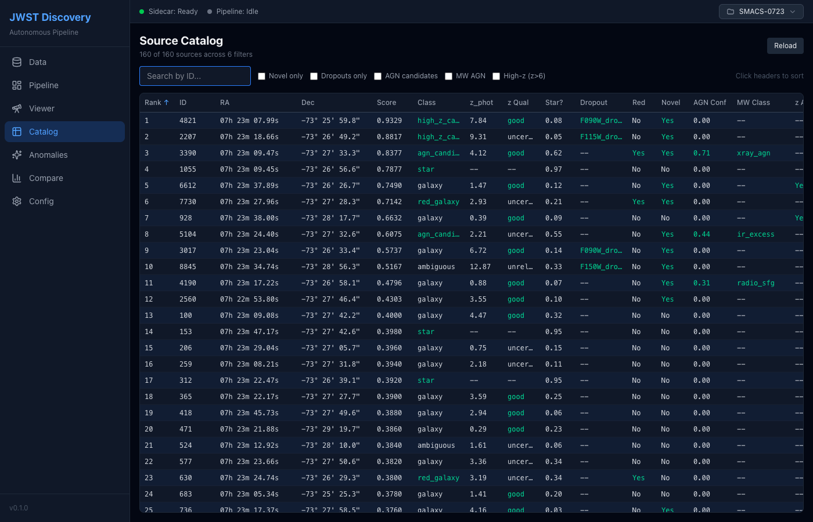
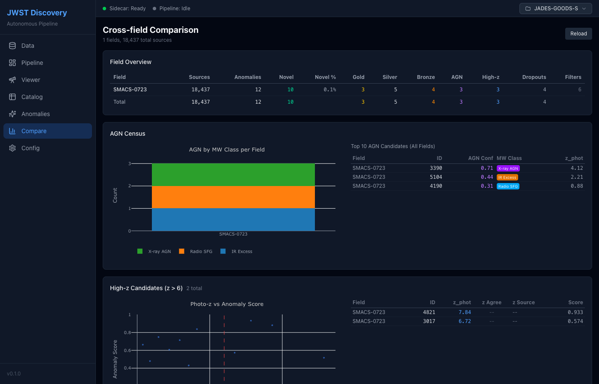

# Using JWST Discovery

A walk through the desktop app, page by page, in the order a field is normally
processed: **Config → Data → Pipeline → Catalog → Anomalies → Sky Viewer → Compare**.
The screenshots are produced by the Playwright suite (`npm run test:e2e`) from a
fixture workspace named `SMACS-0723`, so they show the layout with a small,
synthetic result set rather than a real run.

The left sidebar switches pages. The top bar shows two status pills, **Sidecar**
(the Python pipeline process: `starting`, `ready` or `unavailable`) and
**Pipeline** (`idle`, `running`, `completed`, `failed`), and a workspace selector
listing every field directory under the workspace root.

## 1. Config

Pick a field and the parameters the stages will use.



- **Known Field Presets**: one button per field in the sidecar's registry
  (`sidecar/jwst_pipeline/catalog_registry.py`). Clicking one fills the field
  name, centre RA/Dec, program ID and, when the field has HLSP mosaics, the
  filter list.
- **Target Field**: name (also the workspace directory name, sanitised to
  `[A-Za-z0-9_-]`), program ID, centre RA and Dec in degrees.
- **NIRCam Filters**: toggle the bands to download and measure.
- **Source Detection**: SEP threshold in sigma and minimum area in pixels.
- **Cross-Match**: match radius in arcseconds.
- **Anomaly Detection**: Isolation Forest contamination fraction and how many
  top candidates the report stage writes out.
- **Advanced Processing**: optional Scarlet2 deblending and CIGALE SED fitting
  (both need their Python packages installed).

"Unsaved changes" appears until the values are used by a run; **Reset Defaults**
restores the built-in JADES GOODS-S configuration.

## 2. Data

Search MAST for JWST imaging at the configured position, choose filters and
start the download.


- The page waits for the sidecar to be `ready`, then queries MAST
  automatically. A yellow banner is shown while the process starts; a red one
  if it could not be launched (see
  [BUILDING.md](BUILDING.md#overriding-the-sidecar-at-runtime)).
- **Field Setup** appears when the coordinates match a known field. It lists
  the reference catalogs for that field with their on-disk status and row
  counts, and the HLSP mosaics when the field has them, with buttons to
  download what is missing.
- **JWST Observations (MastMissions)** is a second, collapsed panel that lists
  every program covering the position (PI, instruments, filters, exposure
  time).
- The main list groups Level-3 products by **program ID**. Expand a program to
  see its filters; each filter shows a check mark when the mosaic is already
  in the workspace. **Select All** / **Clear** act per program.
- The action bar at the bottom counts the selection. **Download & Start
  Pipeline** queues the download and switches to the Pipeline page; when every
  selected filter is already on disk the button reads **Re-download & Start**
  and a green **Start Pipeline** shortcut appears.
- **Refresh** re-queries MAST ignoring the cached result; a `cached <date>`
  tag shows when the list came from the cache.
- If the archive query fails, the message from the sidecar appears under
  **Archive query failed**. The MastMissions panel reports its own failures
  inside the panel.

When the pipeline process could not be started, the page says so and the
search button stays disabled:



## 3. Pipeline

Run the nine stages and watch their progress.





- The stage strip and the cards show, in order: Data Ingestion, Preprocessing,
  Source Detection, Deblending, Photometry, Characterization, Cross-Match,
  Anomaly Detection, Report.
- **Run Full Pipeline** runs every stage in sequence. Each card shows its
  status (`idle`, `running`, `completed`, `failed`), a progress bar and the
  sidecar's current message while running, the duration once completed, or the
  error message if it failed.
- Each card also has a **Run** button to execute that stage alone; the next
  stage after the last completed one is highlighted as **Run Next**.
- **Cancel** stops the running pipeline.
- When mosaics are already in the workspace, Data Ingestion is marked
  completed with the number of filters on disk. A **Data Ingestion** panel with
  per-filter download bars appears while a download is in progress.
- **Logs** shows the last 50 log lines from the sidecar, colour-coded by level.

## 4. Catalog

Browse every source the pipeline measured.



- Reads `report/sources_summary.json` from the current workspace. The header
  gives the number of rows shown out of the total and the number of filters.
- Columns: anomaly rank, ID, RA, Dec (sexagesimal), anomaly score, class,
  EAZY photo-z and its quality, stellarity, dropout flag, red excess, novel
  flag, AGN confidence, multi-wavelength class, photo-z agreement, NED and Gaia
  matches, then one AB magnitude column per filter. Values that warrant a look
  (novel, dropout, good photo-z, AGN confidence >= 0.3, ...) are shown in green.
- Click a header to sort; click again to reverse. **Search by ID** filters on
  the ID substring; the checkboxes restrict to novel sources, dropouts, AGN
  candidates, multi-wavelength AGN or z > 6.
- Rows ranked in the top 50 anomalies are tinted blue; clicking one opens the
  Anomalies page.
- The table shows at most 2,000 rows; narrow with the filters to see the rest.

## 5. Anomalies

Inspect the ranked candidates from the anomaly and report stages.


The stats bar counts total sources, novel objects, z > 6 candidates, AGN/LRD
candidates, multi-wavelength AGN, X-ray sources and dropouts. The filter row
has an ID search, quick filters (All, Novel, High-z, AGN/LRD, MW AGN, X-ray,
Radio, Dropouts, Red Excess, Stars, Galaxies) and two sliders for the minimum
peak S/N and the minimum number of bands with S/N >= 5.

Each row is a candidate card. Collapsed, it shows:

| Element | Meaning |
|---------|---------|
| Thumbnail | Detection-image cutout (`report/cutouts/src<id>_detection.png`) |
| `#n` / `NEW` | Anomaly rank, or `NEW` for a novel source that was not ranked |
| `nn%` | Anomaly score as a percentage; red >= 80, orange >= 60, yellow >= 40 |
| `S/N nn` | Peak S/N over all bands; green with >= 3 bands at S/N >= 5, yellow with >= 2, red otherwise |
| AGN bar | Multi-wavelength AGN confidence when >= 30 % |
| `NOVEL` | No counterpart in any reference catalog or live archive within the match radius |
| Class | Star, Galaxy, AGN, High-z, Red Galaxy or Ambiguous, from the characterize stage |
| MW class | X-ray AGN, Obscured AGN, Radio AGN, Radio SFG, X-ray Source or IR Excess, from the multi-wavelength cross-match |
| `z=n.nn` | EAZY photo-z; the suffix `~` marks an uncertain fit, `?` an unreliable one. `z=n.nn cat` is a photo-z taken from a reference catalog when EAZY has none |
| Dropout flag | e.g. `F090W_dropout`: no detection blueward of that band |
| `AGN/LRD`, `RED EXCESS` | Colour-based flags from the characterize stage |
| `NED`, `GAIA`, `X-ray`, `XMM`, `WISE`, `WISE AGN`, `Radio`, `Spitzer`, `eROSITA` | Archive counterparts (shown when no MW class summarises them) |

Click a card to expand it:

- **Spectral Energy Distribution**: an interactive Plotly plot of flux (µJy)
  against pivot wavelength (µm). Filled points are detections at S/N >= 5, open
  points marginal detections at S/N 3–5, downward arrows 2σ upper limits.
  WISE/Spitzer photometry is overlaid when matched. Hover for the per-band
  numbers.
- **Multi-band Cutouts**: the detection cutout followed by one cutout per
  filter, in wavelength order. A missing file shows "No image".
- **Properties**: anomaly score, morphology (stellarity, ellipticity,
  half-light radius), S/N statistics, class, EAZY photo-z with chi² and
  quality, catalog photo-z and spec-z when available, AGN confidence, the
  photo-z agreement verdict (`Agree`, `Disagree` or `CATASTROPHIC` against the
  named catalog), lensing magnification, stellar mass and SFR when CIGALE ran,
  NED name, and the matched X-ray, WISE and radio measurements.
- **Magnitudes & S/N**: AB magnitude and S/N per filter; S/N >= 5 in green.

The page distinguishes "no report yet" (nothing in `report/candidates.json`)
from a read error, and offers **Check again** / **Retry**.

## 6. Sky Viewer

See where the sources are on the sky.


- The map is [Aladin Lite](https://aladin.cds.unistra.fr/AladinLite/), centred
  on the configured RA/Dec with a field of view of twice `field_size_arcmin`.
  The background is the DSS2 colour survey streamed from CDS; the coordinate
  grid is J2000. Aladin's own controls (layers, projection, zoom, full screen)
  are in the corners of the map. Pan by dragging, zoom with the wheel.
- The **overlay** selector draws the pipeline's sources on top: **Anomalies**
  (the candidates from `candidates.json`, red circles), **All Sources (top
  2000)** (the 2,000 best-ranked sources from `sources_summary.json`, blue) or
  **No Overlay**.
- Click a marker to fill the right-hand panel: ID, anomaly rank and score, RA
  and Dec, `NOVEL` and dropout badges, and the detection cutout for the top 50.
- Survey tiles need network access. If Aladin cannot start (no network, no
  WebGL2, or a blocked resource) the panel says why and falls back to a plain
  RA/Dec scatter of the same sources, which is still clickable.

## 7. Compare

Put several processed fields side by side.



- Scans every directory under the workspace root that has a
  `report/candidates.json`.
- **Field Overview**: per field, the number of sources, anomalies, novel
  sources and novel fraction, gold/silver/bronze tier counts, AGN, high-z and
  dropout counts and the number of filters, with a totals row.
- **AGN Census**: a stacked bar chart of multi-wavelength AGN classes per
  field and the ten highest-confidence AGN candidates across all fields.
- **High-z Candidates**: the z > 6 candidates of every field in one table.
- **Cross-field Comparison**: the MW class distribution, the dropout
  breakdown per field and a bar per field for the novel rate.

## Where files go

Each field has its own workspace directory under a common root:

```
<root>/
  <field>/                e.g. SMACS-0723 (the Config "Field Name", sanitised)
    raw/                  Level-3 i2d mosaics downloaded from MAST (*.fits)
    catalogs/             Parquet catalogs written by the stages
    report/
      candidates.json     ranked candidates (read by Anomalies, Viewer, Compare)
      sources_summary.json  all sources, one row each (read by Catalog, Viewer)
      cutouts/            src<id>_detection.png, src<id>_<FILTER>.png
      seds/               SED plots per candidate
```

The root is `~/.jwst-discovery/workspaces` unless `JWST_WORKSPACE_ROOT` is set
in the environment of the app (and of the `jwst-field` CLI, which reads the same
variable). Setting it to an external drive keeps both tools on the same data.
The workspace selector in the top bar lists the directories found under the
root and marks those that already contain a report.

Reference catalogs downloaded from the Data page are shared between fields and
live under `~/.jwst-discovery/` next to the workspaces.

## Running the UI without the Rust host

`npm run test:e2e` drives the front end in headless Chromium with the Tauri
commands answered by `src/e2e/mockTauri.ts` and writes the screenshots in this
document to `docs/screenshots/`. It is also how the Content-Security-Policy of
the packaged app is checked (see
[BUILDING.md](BUILDING.md#content-security-policy-sky-viewer)).
